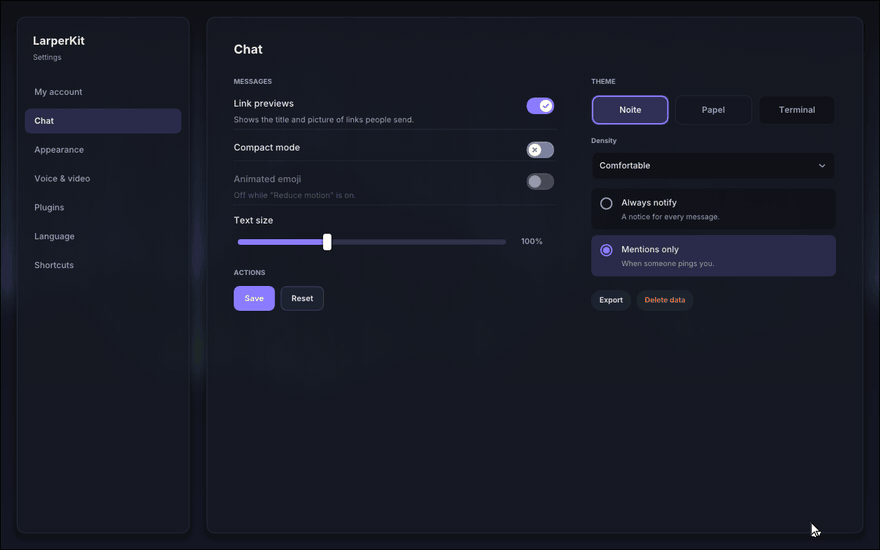
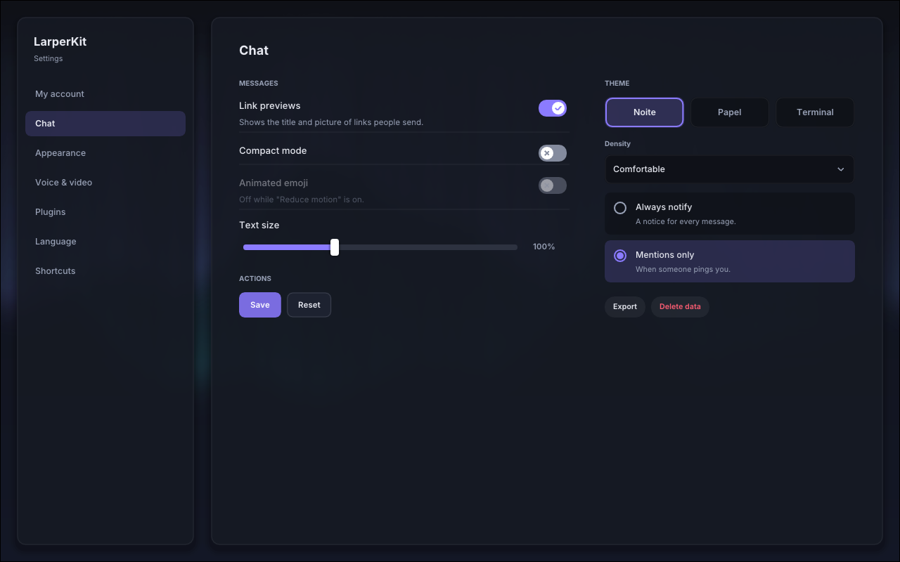
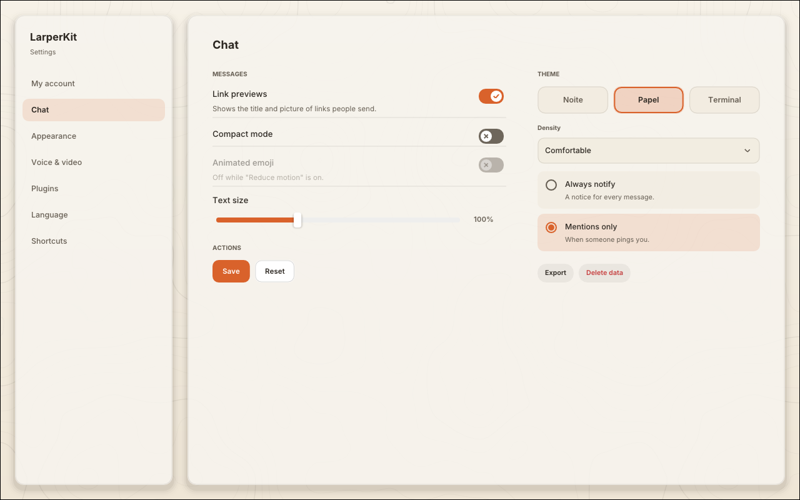
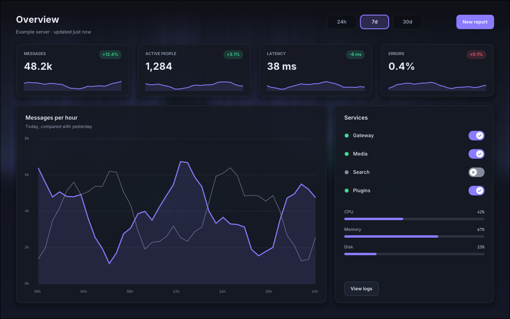
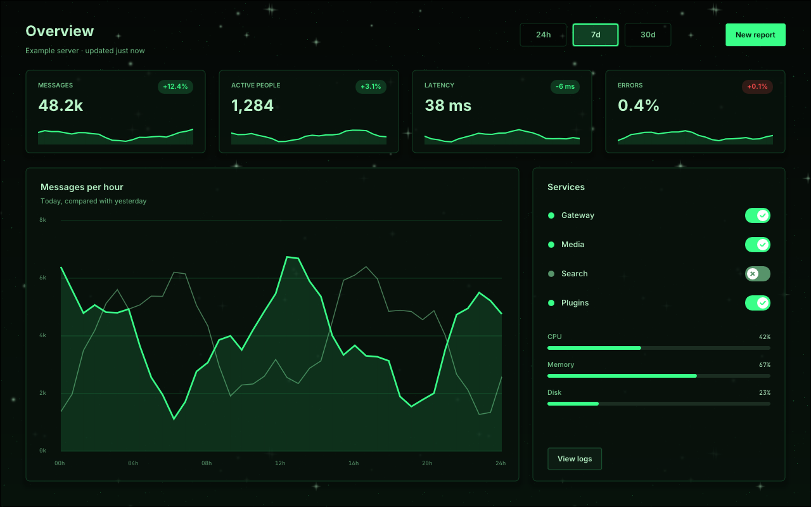
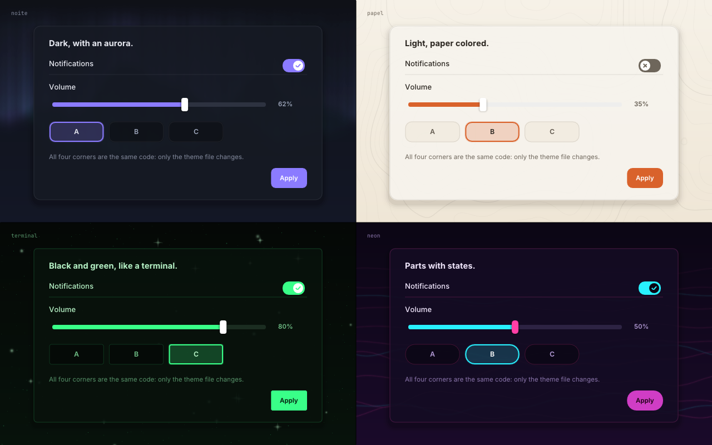
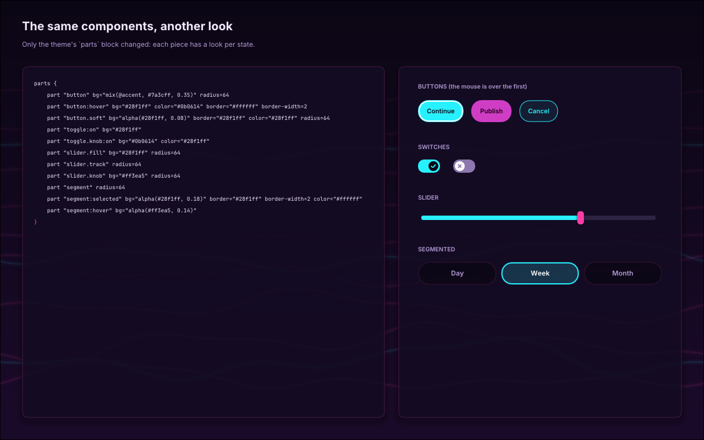

<div align="center">

# Examples

**English** · [Português](EXAMPLES.pt-BR.md)

</div>

Every picture on this page comes from the gallery, [`examples/vitrine`](examples/vitrine/main.zig):
a small app that draws LarperKit's components with its themes and saves the frames. It never opens a
window: SDL's offscreen driver draws into memory, and the gallery reads the pixels back. The themes
are plain KDL files in [`examples/vitrine/temas`](examples/vitrine/temas).

## In motion

The mouse goes over a button, turns on a switch, drags a slider and switches the theme twice. Each
change animates and then stops: when nothing moves, nothing asks for a frame.



## A settings page

The form page (`lk.componentes.Page`): headings, switches with a description, a disabled switch, a
slider, buttons side by side, a segmented control, a select and radio buttons. Each one leaves a mark
for the visual tests and gets its id from a name.



The same page in the paper theme. The code doesn't change, only the theme file:



## A dashboard

Cards, sparklines, a chart, switches and progress bars, drawn with the kit's primitives
(`lk.draw`) and its components. The background is the theme's own: an aurora in the night theme,
a starfield in the terminal one.





## Four themes, one code

The same card in four themes: colors, fonts, corner radius and the procedural background all come
from the theme file.



## Parts with states

A theme can restyle each piece of a component per state, with a `parts` block. On the left, the
block from [`neon.kdl`](examples/vitrine/temas/neon.kdl); on the right, the components it draws (the
first button with the mouse over it):



## Making them again

```sh
tools/deps.sh                       # the Inter and JetBrains Mono fonts (and SDL3 for Windows)
zig build vitrine
SDL_VIDEO_DRIVER=offscreen zig-out/bin/vitrine --out docs/images --fonts .deps/fonts --lang en --frames frames
ffmpeg -framerate 30 -i frames/f%04d.png \
  -vf "fps=20,scale=880:-1:flags=lanczos,split[a][b];[a]palettegen=max_colors=96:stats_mode=diff[p];[b][p]paletteuse=dither=bayer:bayer_scale=4:diff_mode=rectangle" \
  docs/images/demo-en.gif
```

`--lang pt` makes the Portuguese pictures.
