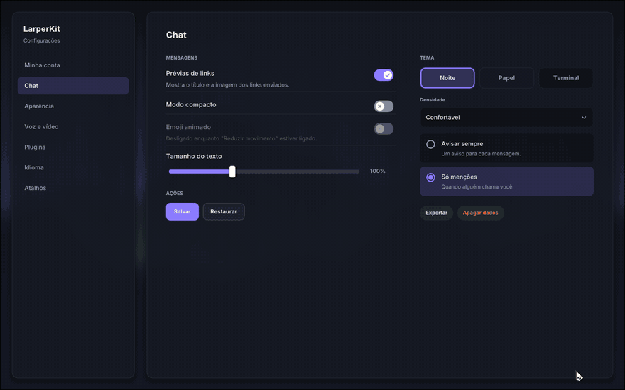
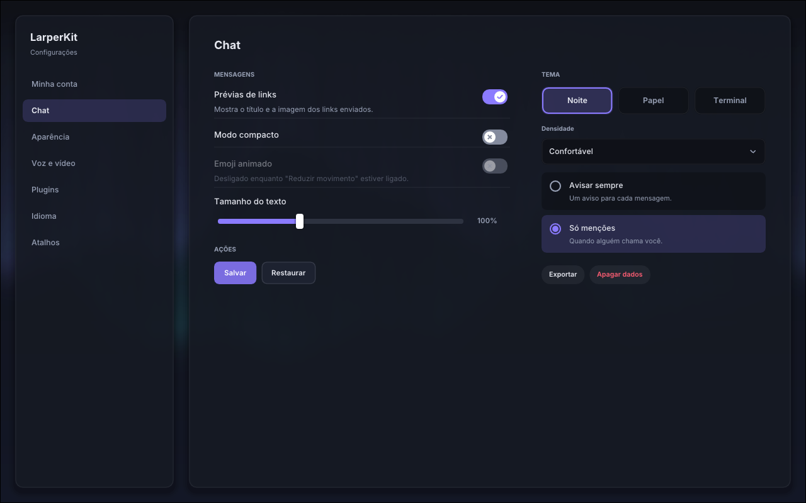
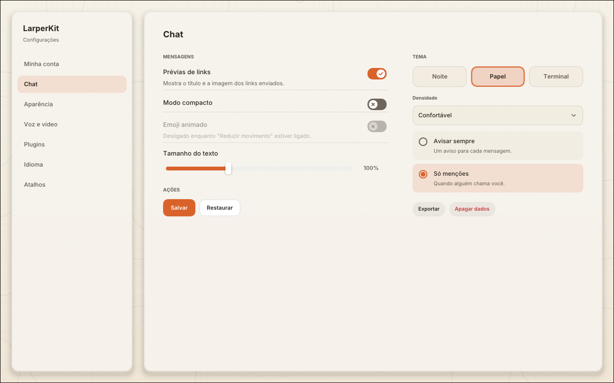
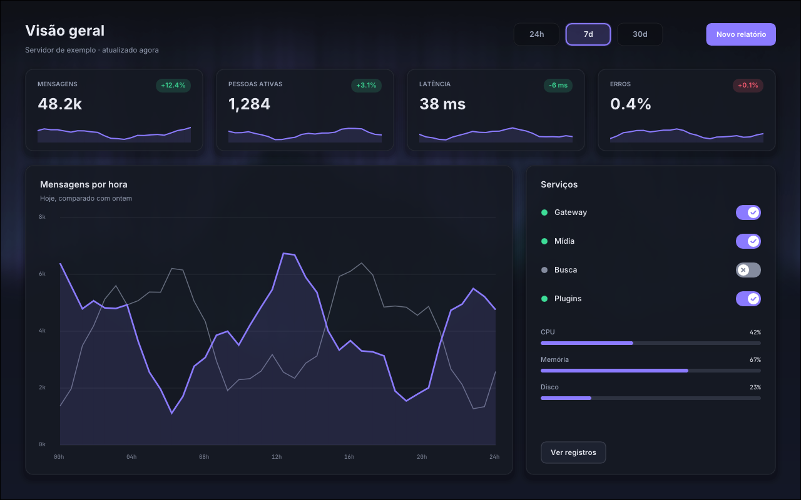
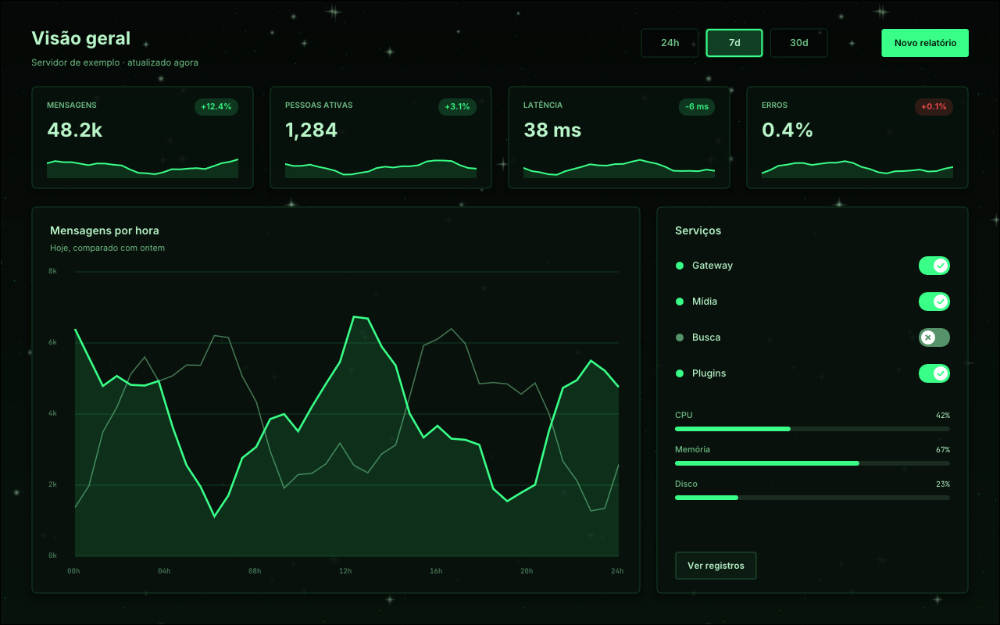
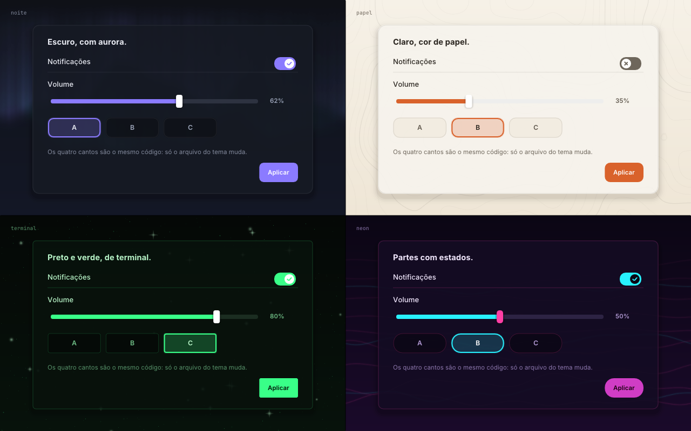
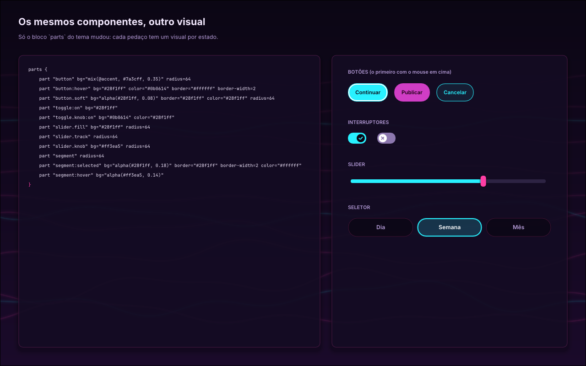

<div align="center">

# Exemplos

[English](EXAMPLES.md) · **Português**

</div>

Todas as imagens desta página saem da vitrine, [`examples/vitrine`](examples/vitrine/main.zig): um
app pequeno que desenha os componentes do LarperKit com os temas dele e grava os quadros. Ele nunca
abre janela: o driver offscreen da SDL desenha na memória, e a vitrine lê os pixels de volta. Os
temas são arquivos KDL comuns, em [`examples/vitrine/temas`](examples/vitrine/temas).

## Em movimento

O mouse passa por um botão, liga um interruptor, arrasta um slider e troca o tema duas vezes. Cada
mudança anima e para: quando nada se mexe, nada pede quadro.



## Uma página de configurações

A página de formulário (`lk.components.Page`): títulos, interruptores com descrição, um
interruptor apagado, um slider, botões lado a lado, um seletor segmentado, um menu de escolha e
opções de rádio. Cada um deixa uma marca para os testes visuais e ganha o id a partir de um nome.



A mesma página no tema papel. O código não muda, só o arquivo do tema:



## Um dashboard

Cartões, minigráficos, um gráfico, interruptores e barras de progresso, desenhados com as
primitivas do kit (`lk.draw`) e com os componentes dele. O fundo é o do próprio tema: uma aurora no
tema noite, um céu de estrelas no terminal.





## Quatro temas, um código

O mesmo cartão em quatro temas: as cores, as fontes, o arredondamento e o fundo procedural vêm do
arquivo do tema.



## Partes com estados

Um tema pode mudar cada pedaço de um componente em cada estado, com um bloco `parts`. À esquerda, o
bloco de [`neon.kdl`](examples/vitrine/temas/neon.kdl); à direita, os componentes que ele desenha (o
primeiro botão com o mouse em cima):



## Um app mínimo

[`examples/hello`](examples/hello) é um projeto Zig separado que depende do kit pelo
`build.zig.zon`, como qualquer app: uma janela que só desenha quando algo muda, um tema, uma
página de formulário e um relógio que outra thread atualiza com `lk.window.wake`.

## Para gerar de novo

```sh
tools/deps.sh                       # as fontes Inter e JetBrains Mono
zig build vitrine
SDL_VIDEO_DRIVER=offscreen zig-out/bin/vitrine --out docs/images --fonts .deps/fonts --lang pt --frames frames
ffmpeg -framerate 30 -i frames/f%04d.png \
  -vf "fps=20,scale=880:-1:flags=lanczos,split[a][b];[a]palettegen=max_colors=96:stats_mode=diff[p];[b][p]paletteuse=dither=bayer:bayer_scale=4:diff_mode=rectangle" \
  docs/images/demo-pt.gif
```

`--lang en` gera as imagens em inglês.
