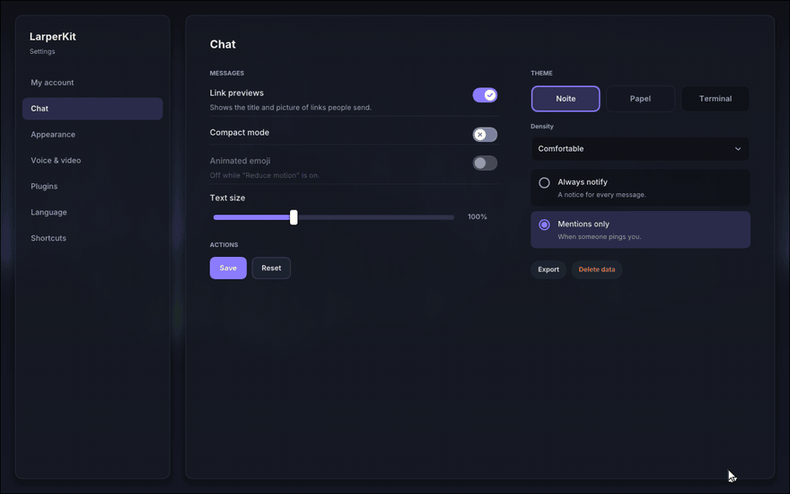
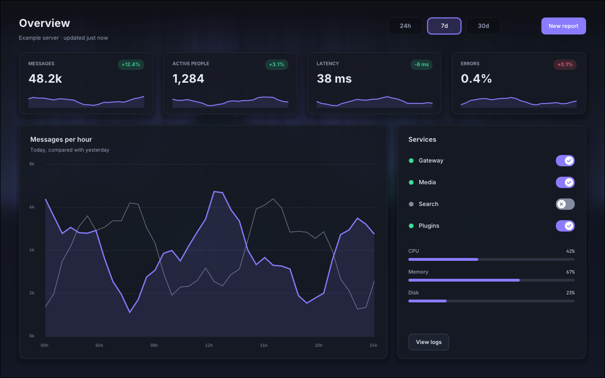
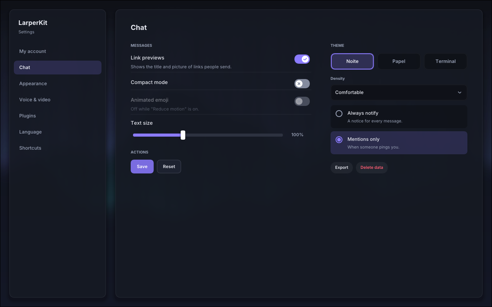
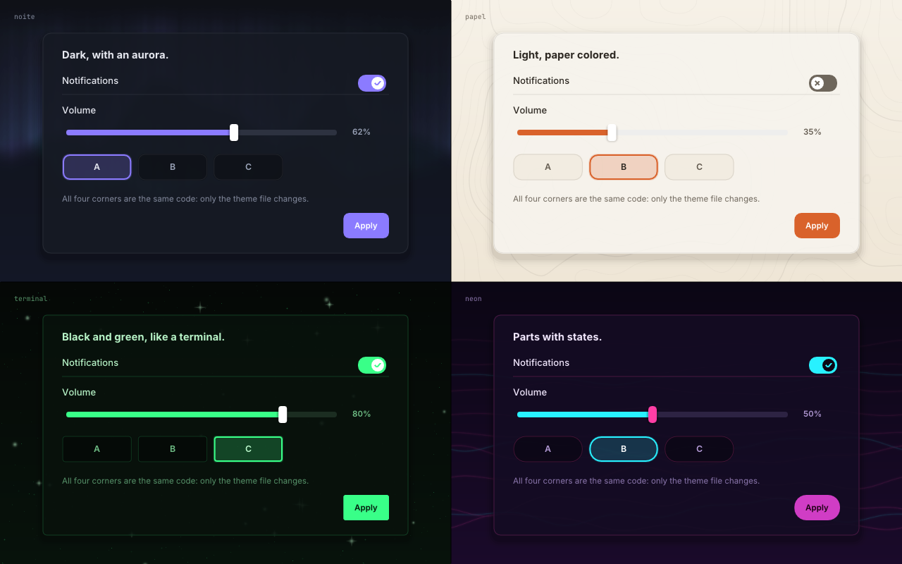
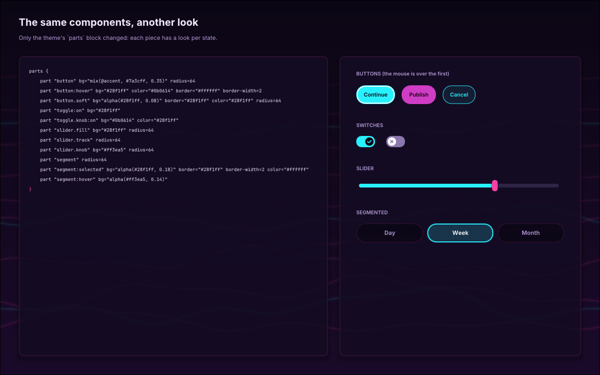

<div align="center">

# LarperKit

**The shared base of my native apps: themes, components, plugins and translations, written once.**

Zig 0.17 · SDL3 · Dear ImGui · KDL · Lua 5.4

**English** · [Português](README.pt-BR.md)

</div>

> [!NOTE]
> Early days. The theme engine, translations, drawing and the first components are here and tested; plugins and fonts come next, and neither [larperCord](https://github.com/RshaCuDeVidro/larperCord) nor larperNotes uses the kit yet (see [Roadmap](#roadmap)). This is a kit for my own programs, so the API changes whenever one of them needs it to.



## Why

larperCord and larperNotes are built the same way. SDL3 opens the window, and Dear ImGui handles input, fonts and text fields. Each app draws its own interface on top, styled by a KDL theme file.

larperNotes started from a copy of larperCord's base, and the two copies have drifted apart. Notes' theme engine is 2,400 lines, and larperCord's is 8,100: schema, parts, a language server, vector shapes and wallpaper are all missing on the Notes side. Every fix has to be carried over by hand, and most never are.

LarperKit keeps that base in one place. An app imports it and gets themes, components and plugins. The app writes only what is its own: its screens, the components its themes can style, and what its plugins are allowed to do.

## Using it in an app

Add the kit to your `build.zig.zon` (pin a tag; see [CHANGELOG.md](CHANGELOG.md)):

```sh
zig fetch --save git+https://github.com/RshaCuDeVidro/LarperKit#v0.1.2
```

Then, in `build.zig`, import the module. It brings Dear ImGui, the SDL3 backends and SDL3
itself (on Windows, downloaded by the build; on Linux, the system's `sdl3` through pkg-config):

```zig
const kit = b.dependency("larperkit", .{ .target = target, .optimize = optimize });
exe.root_module.addImport("larperkit", kit.module("larperkit"));
@import("larperkit").installSdl(b, kit); // SDL3.dll next to the .exe on Windows
// Translations, if the app has an i18n/ folder with <code>.kdl files:
exe.root_module.addImport("translations", @import("larperkit").translations(b, kit.builder, "i18n"));
```

And open a window. The loop sleeps while nothing changes and wakes for input, for an animation
or for `lk.window.wake(code)` from another thread:

```zig
const lk = @import("larperkit");

pub fn main(init: std.process.Init) !void {
    lk.app.name = "My app";       // in messages
    lk.app.folder = "my-app";     // ~/.config/my-app, %APPDATA%\my-app
    lk.components.register();
    var theme = try lk.theme.load(init.gpa, @embedFile("theme.kdl"), null, null);
    defer theme.deinit();
    var state: State = .{};
    try lk.window.run(.{ .title = "My app", .theme = &theme }, &state, draw);
}

fn draw(s: *State, ctx: *lk.draw.Ctx) void {
    var p: lk.components.Page = .{ .ctx = ctx, .dl = ctx.dl, .x = 40, .y = 40, .w = 480, .scope = lk.id("main", 0) };
    p.title("Hello");
    p.toggle("Compact mode", "", &s.compact);
}
```

[`examples/hello`](examples/hello) is a complete app built this way. Build options of the
`larperkit` dependency: `.imgui = false` for an app that compiles its own Dear ImGui,
`.link_sdl = false` for one that links SDL3 its own way, `.qa = true` for the visual test marks
(on by default in Debug only).

## Examples

Drawn by the gallery ([`examples/vitrine`](examples/vitrine/main.zig)) without opening a window. More in **[EXAMPLES.md](EXAMPLES.md)**.

| | |
| --- | --- |
|  |  |
|  |  |

## What goes in

- **Themes.** KDL theme files described by one schema. That schema checks a theme on load (warnings with line and column, and suggestions for typos) and powers `--theme-check` and a language server for editors. Themes get `extends` and `vars`, parts with states (`part "button:hover"`), vector shapes, procedural backgrounds and a local wallpaper. Each app registers its own components in the schema.
- **Components.** Button, icon button, toggle, slider, segmented control, dropdown, tooltip, toast, modal, menu, scroll area and text field.
  - Each one takes its look from the theme, follows the single UI scale factor and works right to left.
  - Each one gets its id from a name (`id("save", i)`) instead of a hand-picked number, in the style of [WooferSoundPad](https://github.com/RshaCuDeVidro/WooferSoundPad).
  - Each one reports itself to the Inspector and leaves a mark for the visual tests, so a new screen is testable from day one.
- **Idle by default.** Nothing is drawn while nothing changes, and an animation asks for frames only while it moves.
- **Plugins.** The Lua 5.4 runtime: the sandbox, manifests, permissions, HTTP with per-host rules, secrets in the system keychain, translated labels and the plugin panel. The app decides which functions its plugins get.
- **Translations.** Languages come from `.kdl` files, with plural forms, live reload and a coverage count per language.
- **Text.** Fonts with per-script fallback to the system's fonts, plus the patched Dear ImGui (right-to-left text, input methods and the font changes) that both apps build on.
- **Gallery.** A small app that draws every component in every theme: light and dark, at other scales, and right to left. It is both the demo and the target of the visual tests, so the kit tests itself without opening an app. The first version makes the pictures in [EXAMPLES.md](EXAMPLES.md).

## API

What it looks like today. It will change as the apps move over.

```zig
const lk = @import("larperkit");
const comp = lk.components;

fn settingsPage(ctx: *lk.draw.Ctx, s: *Settings) void {
    var p: comp.Page = .{ .ctx = ctx, .dl = ctx.dl, .x = 40, .y = 40, .w = 480, .scope = lk.id("settings", 0) };
    p.title("Chat");
    p.toggle("Compact mode", "", &s.compact);
    p.slider("Text size", &s.text_size, 0.8, 1.4, "{d:.0}%", 100);
    if (p.button("Save", false)) s.save();
    for (s.accounts, 0..) |_, i| {
        const r: lk.draw.Rect = .{ .x = 40, .y = p.y + @as(f32, @floatFromInt(i)) * 40, .w = 120, .h = 32 };
        if (comp.button(ctx, ctx.dl, lk.id("remove-account", i), r, "Remove", .{ .kind = .pill, .danger = true })) s.remove(i);
    }
}
```

The same components in a theme:

```kdl
parts {
    part "button:hover" bg="@accent" radius=6
    part "toggle.knob:on" color="@accent"
}
```

## Roadmap

- [x] **Core:** the theme engine, ids, animation, drawing and translations, taken from larperCord's current code.
- [ ] **larperNotes** switches to the core and drops its own copies.
- [ ] **Components** and the gallery. Button, toggle, slider, segmented control and the form page are in, and the gallery makes the [examples](EXAMPLES.md).
- [ ] **Plugin runtime.**
- [ ] **Fonts** and the patched Dear ImGui.
- [ ] **larperCord** switches over one module at a time, after its 0.7 release.

## License

GPL-3.0, the same as larperCord, since most of the code comes from it.
