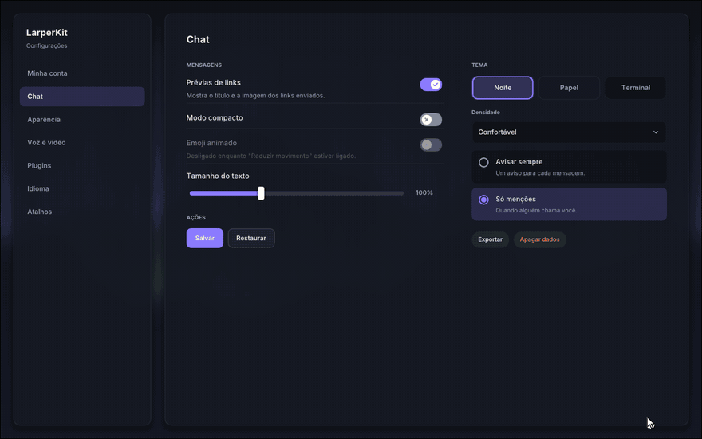
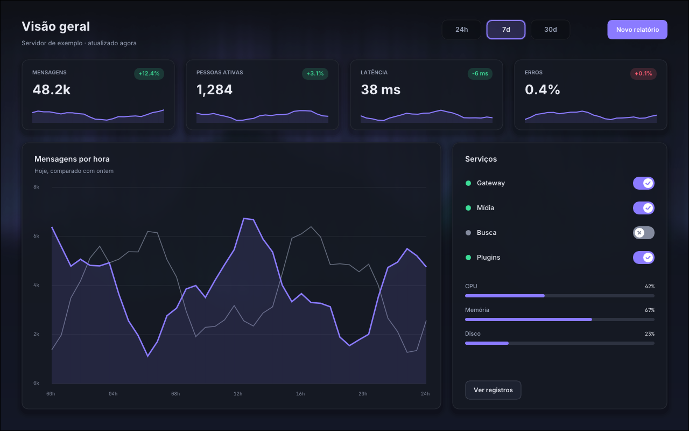
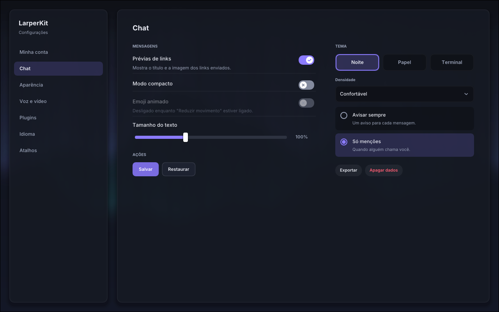
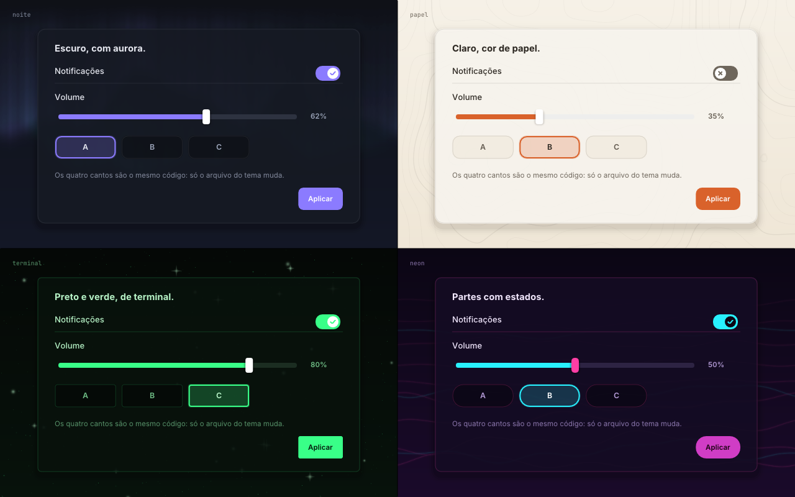
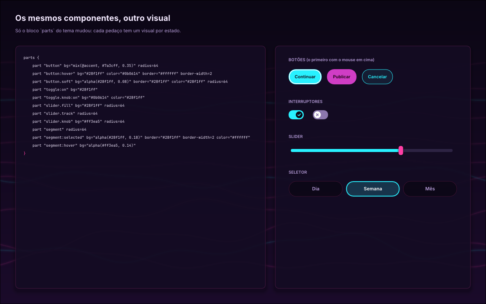

<div align="center">

# LarperKit

**A base comum dos meus apps nativos: temas, componentes, plugins e traduções, escritos uma vez só.**

Zig 0.17 · SDL3 · Dear ImGui · KDL · Lua 5.4

[English](README.md) · **Português**

</div>

> [!NOTE]
> Bem no começo. O motor de temas, as traduções, o desenho e os primeiros componentes já estão aqui e testados; os plugins e as fontes vêm depois, e nem o [larperCord](https://github.com/RshaCuDeVidro/larperCord) nem o larperNotes usam o kit ainda (veja o [Roteiro](#roteiro)). É um kit para os meus próprios programas, então a API muda sempre que um deles precisar.



## Por quê

O larperCord e o larperNotes são feitos do mesmo jeito. O SDL3 abre a janela, e o Dear ImGui cuida do teclado e do mouse, das fontes e das caixas de texto. Cada app desenha a própria interface por cima, com o visual vindo de um arquivo de tema KDL.

O larperNotes começou de uma cópia da base do larperCord, e as duas cópias foram se afastando. O motor de temas do Notes tem 2.400 linhas, e o do larperCord tem 8.100: falta no Notes o esquema, as partes, o servidor de linguagem, as formas vetoriais e o papel de parede. Cada correção precisa ser levada de um para o outro na mão, e a maioria nunca é.

O LarperKit guarda essa base num lugar só. Um app importa o kit e ganha temas, componentes e plugins. O app só escreve o que é dele: as telas, os componentes que os temas dele podem estilizar e o que os plugins dele podem fazer.

## Usando num app

Ponha o kit no `build.zig.zon` (fixe uma tag; veja o [CHANGELOG.md](CHANGELOG.md)):

```sh
zig fetch --save git+https://github.com/RshaCuDeVidro/LarperKit#v0.1.1
```

Depois, no `build.zig`, importe o módulo. Ele já traz o Dear ImGui, os backends da SDL3 e a
própria SDL3 (no Windows, baixada pelo build; no Linux, a `sdl3` do sistema, pelo pkg-config):

```zig
const kit = b.dependency("larperkit", .{ .target = target, .optimize = optimize });
exe.root_module.addImport("larperkit", kit.module("larperkit"));
@import("larperkit").installSdl(b, kit); // o SDL3.dll ao lado do .exe no Windows
// As traduções, se o app tem uma pasta i18n/ com os <código>.kdl:
exe.root_module.addImport("translations", @import("larperkit").translations(b, kit.builder, "i18n"));
```

E abra uma janela. O laço dorme enquanto nada muda e acorda com a entrada, com uma animação ou
com `lk.window.wake(código)` de outra thread:

```zig
const lk = @import("larperkit");

pub fn main(init: std.process.Init) !void {
    lk.app.name = "Meu app";      // nas mensagens
    lk.app.folder = "meu-app";    // ~/.config/meu-app, %APPDATA%\meu-app
    lk.components.register();
    var theme = try lk.theme.load(init.gpa, @embedFile("theme.kdl"), null, null);
    defer theme.deinit();
    var state: State = .{};
    try lk.window.run(.{ .title = "Meu app", .theme = &theme }, &state, draw);
}

fn draw(s: *State, ctx: *lk.draw.Ctx) void {
    var p: lk.components.Page = .{ .ctx = ctx, .dl = ctx.dl, .x = 40, .y = 40, .w = 480, .scope = lk.id("main", 0) };
    p.title("Olá");
    p.toggle("Modo compacto", "", &s.compact);
}
```

[`examples/hello`](examples/hello) é um app completo feito assim. Opções da dependência
`larperkit`: `.imgui = false` para um app que compila o próprio Dear ImGui, `.link_sdl = false`
para um que liga a SDL3 do jeito dele, `.qa = true` para as marcas dos testes visuais (ligadas
por padrão só no Debug).

## Exemplos

Desenhados pela vitrine ([`examples/vitrine`](examples/vitrine/main.zig)) sem abrir janela. Mais em **[EXAMPLES.pt-BR.md](EXAMPLES.pt-BR.md)**.

| | |
| --- | --- |
|  |  |
|  |  |

## O que entra

- **Temas.** Arquivos de tema KDL descritos por um esquema só. Esse esquema confere o tema ao carregar (avisos com linha e coluna, e sugestão para erro de digitação) e alimenta o `--theme-check` e um servidor de linguagem para editores. Os temas ganham `extends` e `vars`, partes com estados (`part "button:hover"`), formas vetoriais, fundos procedurais e papel de parede local. Cada app registra os próprios componentes no esquema.
- **Componentes.** Botão, botão de ícone, interruptor, slider, seletor segmentado, menu suspenso, dica, aviso, janela de diálogo, menu, área de rolagem e caixa de texto.
  - Cada um pega o visual do tema, segue o fator de escala único da interface e funciona da direita para a esquerda.
  - Cada um ganha o identificador a partir de um nome (`id("save", i)`), e não de um número escolhido na mão, no estilo do [WooferSoundPad](https://github.com/RshaCuDeVidro/WooferSoundPad).
  - Cada um se registra no Inspetor e deixa uma marca para os testes visuais, então uma tela nova já nasce testável.
- **Parado por padrão.** Nada é desenhado enquanto nada muda, e uma animação só pede quadros enquanto se mexe.
- **Plugins.** O runtime de Lua 5.4: a sandbox, os manifestos, as permissões, o HTTP com regras por host, os segredos no chaveiro do sistema, os textos traduzidos e o painel dos plugins. O app decide quais funções os plugins dele recebem.
- **Traduções.** Os idiomas vêm de arquivos `.kdl`, com formas de plural, recarga na hora e quanto cada idioma traduz.
- **Texto.** Fontes que buscam no sistema a escrita que faltar, e o Dear ImGui modificado (texto da direita para a esquerda, métodos de entrada e as mudanças nas fontes) em que os dois apps se apoiam.
- **Vitrine.** Um app pequeno que desenha cada componente em cada tema: claro e escuro, em outras escalas e da direita para a esquerda. Ele é a demonstração e o alvo dos testes visuais ao mesmo tempo, então o kit se testa sozinho, sem abrir um app. A primeira versão já faz as imagens de [EXAMPLES.pt-BR.md](EXAMPLES.pt-BR.md).

## API

Como está hoje. Vai mudar conforme os apps passarem para o kit.

```zig
const lk = @import("larperkit");
const comp = lk.components;

fn settingsPage(ctx: *lk.draw.Ctx, s: *Settings) void {
    var p: comp.Page = .{ .ctx = ctx, .dl = ctx.dl, .x = 40, .y = 40, .w = 480, .scope = lk.id("settings", 0) };
    p.title("Chat");
    p.toggle("Compact mode", "", &s.compact);
    p.slider("Text size", &s.text_size, 0.8, 1.4, "{d:.0}%", 100);
    if (p.button("Save", false)) s.save();
    for (s.accounts, 0..) |_, i| {
        const r: lk.draw.Rect = .{ .x = 40, .y = p.y + @as(f32, @floatFromInt(i)) * 40, .w = 120, .h = 32 };
        if (comp.button(ctx, ctx.dl, lk.id("remove-account", i), r, "Remove", .{ .kind = .pill, .danger = true })) s.remove(i);
    }
}
```

Os mesmos componentes num tema:

```kdl
parts {
    part "button:hover" bg="@accent" radius=6
    part "toggle.knob:on" color="@accent"
}
```

## Roteiro

- [x] **Base:** o motor de temas, os identificadores, as animações, o desenho e as traduções, tirados do código atual do larperCord.
- [ ] **larperNotes** passa a usar a base e larga as cópias dele.
- [ ] **Componentes** e a vitrine. O botão, o interruptor, o slider, o seletor segmentado e a página de formulário já entraram, e a vitrine faz os [exemplos](EXAMPLES.pt-BR.md).
- [ ] **Runtime de plugins.**
- [ ] **Fontes** e o Dear ImGui modificado.
- [ ] **larperCord** passa a usar o kit, um módulo por vez, depois que a 0.7 sair.

## Licença

GPL-3.0, a mesma do larperCord, já que a maior parte do código vem de lá.
